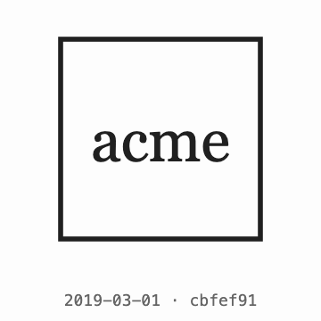

<h1 align="center">skillsed</h1>

<p align="center">
  <em>Skills by Ed</em>
</p>

<p align="center">
  
  
  
</p>

---

## animate-file-history

<p align="center">
  
</p>

<p align="center">
  <strong>Your logo's whole life story, straight out of git.</strong><br>
  One frame per version that actually <em>looks</em> different. Re-exports and reformatted SVGs are skipped.
</p>

```
/animate-file-history all images matching "logo"
/animate-file-history all versions of our home page
```

### In the wild: Storra

<p align="center">
  
</p>

<p align="center">
  Seven months of <a href="https://github.com/storra-eng">Storra</a>'s logo, from a lowercase wordmark through
  red S monograms to today's folded-page mark - stitched from favicons, headers and brand lockups across 27
  commits.
</p>

The agent works out which files you mean (following renames, moves and `png` → `svg` switches across the
whole history), pulls every version out of git, renders each one, drops versions whose pixels are identical
to the one before, and stitches the rest into a GIF or MP4 with date and commit captions.

- **Logos, icons, images**: `png`, `jpg`, `webp`, `gif`, `bmp`, `svg`.
- **Web pages**: static HTML is screenshotted at each commit; framework pages (React, Next, Vue, ...) are
  installed from each commit's own lockfile, run and screenshotted with Playwright once images have loaded,
  sampled when the history is long. Blank and error pages (and flat-colour frames) are skipped, and images the
  dev server can't serve can be fetched from your production site.
- **Visual dedupe**: compared on rendered pixels, not bytes, so only real visual changes become frames.

Needs `git` and `ffmpeg`. SVGs need `rsvg-convert` or Chrome/Chromium; captions and pages need
Chrome/Chromium; framework pages also need `playwright-core` (the app's own install is used if it has one).

### Options

Say them in the request (`/animate-file-history our logo, 0.5s per frame, as an mp4`) and the agent passes
them on, or run the engine by hand:
[`skills/animate-file-history/scripts/animate-history.sh`](skills/animate-file-history/scripts/animate-history.sh).

| Option | Default | What it does |
|---|---|---|
| `-t, --frame-time S` | `0.25` (`0.8` with `--frames`) | Seconds each version is shown (`-f, --fps N` sets versions per second instead) |
| `--hold S` | `1.5` | Seconds to hold the final version |
| `-o, --out FILE` | `<name>-history.gif` | Output file; `.gif` or `.mp4` |
| `-s, --size N\|WxH` | `512` | Canvas size; every version is centred on it |
| `--bg COLOR` | `white` | Canvas background, also fills transparent areas |
| `--label` | off | Caption each frame with its commit date and short sha |
| `--keep-blank` | off | Keep frames that are one flat colour (skipped by default) |
| `--skip SHA` | - | Leave out one version; repeatable |
| `--keep DIR` | - | Keep the rendered frames as PNGs |
| `--frames DIR` | - | Animate a folder of pre-rendered PNGs (page screenshots, or frames merged from several repos) |
| `-C DIR` | cwd | Run against the git repo at `DIR` |

## Install

**Claude Code**, as two separate prompts:

```
/plugin marketplace add echarrod/skillsed
```
```
/plugin install skillsed@skillsed
```

Or in one step on Claude Code 2.1.275 or later:

```
/plugin install skillsed --marketplace echarrod/skillsed
```

Installed as a plugin, the command is namespaced: `/skillsed:animate-file-history`.

**Any agent that reads `SKILL.md`** (Codex, Cursor, Gemini CLI, OpenCode, Copilot and others):

```bash
npx skills add echarrod/skillsed
```

**By hand**: clone the repo and symlink or copy a skill folder into `~/.claude/skills/` (every project) or
a project's `.claude/skills/`. Installed this way the command is plain `/animate-file-history`.

```bash
git clone https://github.com/echarrod/skillsed.git
ln -s "$PWD/skillsed/skills/animate-file-history" ~/.claude/skills/animate-file-history
```

To link every skill in the repo at once (into `~/.claude/skills` and `~/.agents/skills`), run
`skillsed/scripts/link-skills.sh`; re-run it after pulling new skills.

## Model and effort

Haiku at low effort is enough for images: every model and effort setting benchmarked gave the same correct output. Results and how to rerun them are in
[`benchmarks/`](benchmarks/README.md).

## Layout

- `skills/<name>/SKILL.md` - the skill (frontmatter `name` + `description`, then the body).
- `skills/<name>/scripts/` - executable helpers the skill runs.
- `skills/<name>/references/` - supporting detail loaded on demand.

## License

[MIT](LICENSE)
